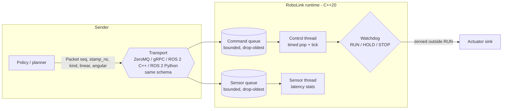
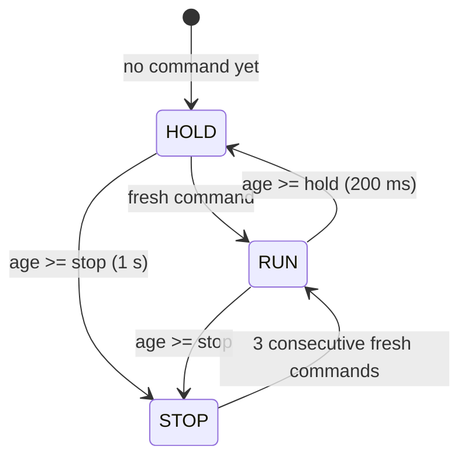

# RoboLink

Low-latency AI-robot communication and control runtime in C++20, plus a benchmark harness that compares ZeroMQ, gRPC, ROS 2 C++ (rclcpp) and ROS 2 Python (rclpy) on one shared message schema.

## Why

A learned policy or remote planner is only useful if its commands reach the robot fresh. A late command is worse than no command: the robot executes stale intent. RoboLink explores two questions:

1. How should a robot-side runtime behave when commands get old? (bounded queues, timestamps, timeouts, and a watchdog that goes HOLD, then STOP.)
2. What do different transports and languages actually cost in latency, jitter, throughput and CPU, especially under CPU load and network delay?

## What is implemented

| Part | Where | Status |
|---|---|---|
| Timestamped packets (CLOCK_MONOTONIC ns), packet age | `include/robolink/packet.hpp` | tested |
| Bounded MPMC queue: reject-when-full, drop-oldest, timed pop, close | `include/robolink/bounded_queue.hpp` | tested (incl. concurrent stress) |
| Stale-command watchdog: RUN, HOLD (age >= 200 ms), STOP (age >= 1 s, latched until 3 fresh commands); rejects too-old and out-of-order commands | `src/watchdog.cpp` | tested |
| Runtime: separate command and sensor pipeline threads, control tick, queue-timeout handling, output forced to zero outside RUN | `src/runtime.cpp` | tested |
| One schema (`proto/robolink.proto`) over ZeroMQ and gRPC (C++), and a mirrored `.msg` for ROS 2 C++ and Python | `proto/`, `ros2/` | benchmarked |
| Benchmark harness (p50/p95/p99, jitter, throughput, CPU; Python vs C++ control loop under CPU stress and netem) | `bench/` | see Results |
| Terminal dashboard demo | `bench/demo.cpp` | runs natively |

The watchdog thresholds are configurable. The benchmark transports are measured as echo/stream endpoints; the runtime itself is exercised end to end over ZeroMQ in the demo, not wired to gRPC or ROS 2.

## Architecture



Watchdog state machine (command age = now minus the timestamp of the newest accepted command):



## Quick start

Requires CMake, a C++20 compiler, and (Homebrew shown) `brew install zeromq cppzmq grpc protobuf googletest`.

```sh
make test demo      # build with -Wall -Wextra -Werror, run unit tests, run the ~15 s terminal demo
```

Other targets: `make tsan`, `make asan` (sanitizer unit tests), `make bench` (macOS/Linux native benchmarks into `results/<os>/`), `scripts/docker_bench.sh` (ROS 2 + netem in Docker; start Colima first).

Note: Homebrew's gRPC must match its protobuf and abseil versions (`brew upgrade grpc` fixes a mismatch).

## Demo


*`make demo`: commands stall, the watchdog goes HOLD then STOP, and the link restoring returns it to RUN.*

## Results

All numbers below were produced by the commands recorded in the linked `results/` files, on the machine named in each section. Do not compare numbers across the macOS and Docker sections: they are different kernels, different CPUs allocations, and the Docker numbers include a VM.

<!-- RESULTS:BEGIN -->

#### macOS native (Apple M1, no VM)

**Transport latency, jitter, throughput, CPU**

Machine: Apple M1 (8 logical CPUs, 8.0 GB), macOS 26.2, **macos-native**; load average at start (1/5/15 min): 3.5, 4.4, 6.6.

Raw: `results/macos/transport_zmq_grpc.json` (+ `.raw.csv`). Command: `bench/run_bench.py transport --bin build/rl_bench --transports zmq grpc --out results/macos/transport_zmq_grpc.json`. Latency = round-trip time, 5000 samples/run at 1000 Hz after 200 warm-up, 64 B payload, median of 3 runs. Throughput = 3 s unpaced send, median of runs. CPU = client + server CPU time / wall time, in % of one core.

| Transport | p50 RTT (us) | p95 (us) | p99 (us) | jitter (us) | latency-run CPU (% core) | throughput (msg/s) | delivered | throughput-run CPU (% core) |
|---|---|---|---|---|---|---|---|---|
| zmq_cpp | 229 | 447 | 1,132 | 98.9 | 20.0 | 2,314,823 | 100.0% | 213 |
| grpc_cpp | 336 | 524 | 922 | 62.0 | 49.3 | 48,935 | 100.0% | 227 |

**Python vs C++ control loop**

Machine: Apple M1 (8 logical CPUs, 8.0 GB), macOS 26.2, **macos-native**; load average at start (1/5/15 min): 3.2, 4.1, 6.3.

Raw: `results/macos/control_*.json` (+ `.raw.csv`). 1000 cycles per run at 100 Hz, 5 runs, medians. Plant watchdog thresholds: HOLD 8 ms, STOP 50 ms. Loop RTT = send command until the plant's reply arrives; wake lateness = actual cycle start minus scheduled start; overrun = cycle finished after its deadline.

| Scenario | Controller | RTT p50 (us) | p95 (us) | p99 (us) | jitter (us) | wake-late p99 (us) | overruns (%) | CPU (% core) | cmds held/stopped by plant / total |
|---|---|---|---|---|---|---|---|---|---|
| no stress | cpp | 417 | 729 | 2,383 | 191 | 2,444 | 0.2 | 2.2 | 0 / 1,000 |
| no stress | python | 490 | 866 | 2,291 | 227 | 3,541 | 0.2 | 2.9 | 0 / 1,000 |
| CPU stress (stress-ng, 8 workers) | cpp | 269 | 472 | 1,256 | 97 | 4,798 | 0.1 | 1.4 | 0 / 1,000 |
| CPU stress (stress-ng, 8 workers) | python | 338 | 725 | 1,821 | 190 | 4,849 | 0.4 | 2.0 | 0 / 1,000 |

#### Docker / Linux (Colima VM, 2 vCPU, 3 GB)

**Transport latency, jitter, throughput, CPU**

Machine: virtual aarch64 CPU (VM on an Apple M1 host; guest does not expose the model) (2 logical CPUs, 2.8 GB), Ubuntu 24.04.5 LTS, **docker-linux (Colima VM)**; load average at start (1/5/15 min): 1.6, 0.7, 0.5.

Raw: `results/docker/transport_all.json` (+ `.raw.csv`). Command: `bench/run_bench.py transport --bin /tmp/build/rl_bench --transports zmq grpc --ros2-cpp /tmp/ros_ws/install/robolink_bench/lib/robolink_bench/bench_cpp --ros2-py python3 /tmp/ros_ws/install/robolink_bench/lib/robolink_bench/bench_py.py --ready 3 --note docker/Linux on Colima VM; loopback --out results/docker/transport_all.json`. Latency = round-trip time, 5000 samples/run at 1000 Hz after 200 warm-up, 64 B payload, median of 3 runs. Throughput = 3 s unpaced send, median of runs. CPU = client + server CPU time / wall time, in % of one core.

| Transport | p50 RTT (us) | p95 (us) | p99 (us) | jitter (us) | latency-run CPU (% core) | throughput (msg/s) | delivered | throughput-run CPU (% core) |
|---|---|---|---|---|---|---|---|---|
| zmq_cpp | 368 | 896 | 2,504 | 211.3 | 37.4 | 605,462 | 100.0% | 183 |
| grpc_cpp | 283 | 919 | 2,518 | 236.0 | 43.9 | 46,787 | 100.0% | 149 |
| ros2_cpp | 280 | 751 | 1,695 | 147.9 | 42.4 | 12,549 | 100.0% | 129 |
| ros2_py | 457 | 1,161 | 2,681 | 200.4 | 113.5 | 420 | 100.0% | 121 |

**Python vs C++ control loop**

Machine: virtual aarch64 CPU (VM on an Apple M1 host; guest does not expose the model) (2 logical CPUs, 2.8 GB), Ubuntu 24.04.5 LTS, **docker-linux (Colima VM)**; load average at start (1/5/15 min): 0.7, 0.6, 0.3.

Raw: `results/docker/control_*.json` (+ `.raw.csv`). 1000 cycles per run at 100 Hz, 3 runs, medians. Plant watchdog thresholds: HOLD 8 ms, STOP 50 ms. Loop RTT = send command until the plant's reply arrives; wake lateness = actual cycle start minus scheduled start; overrun = cycle finished after its deadline.

| Scenario | Controller | RTT p50 (us) | p95 (us) | p99 (us) | jitter (us) | wake-late p99 (us) | overruns (%) | CPU (% core) | cmds held/stopped by plant / total |
|---|---|---|---|---|---|---|---|---|---|
| no stress | cpp | 445 | 1,101 | 2,408 | 241 | 4,924 | 0.4 | 2.9 | 0 / 1,000 |
| no stress | python | 521 | 1,374 | 3,443 | 327 | 4,898 | 0.5 | 4.3 | 2 / 1,000 |
| CPU stress (stress-ng, 4 workers) | cpp | 166 | 2,167 | 5,618 | 817 | 8,144 | 1.9 | 1.7 | 4 / 1,000 |
| CPU stress (stress-ng, 4 workers) | python | 160 | 1,742 | 3,540 | 485 | 1,920 | 0.1 | 1.5 | 0 / 1,000 |
| no stress + netem `delay 2ms 1ms` on lo | cpp | 6,329 | 8,435 | 9,228 | 1,416 | 2,931 | 5.0 | 1.3 | 1 / 1,000 |
| no stress + netem `delay 2ms 1ms` on lo | python | 6,237 | 8,296 | 8,895 | 1,442 | 2,923 | 3.9 | 1.5 | 1 / 1,000 |
| CPU stress (stress-ng, 4 workers) + netem `delay 2ms 1ms` on lo | cpp | 4,193 | 5,801 | 6,943 | 1,074 | 1,695 | 0.1 | 0.5 | 0 / 1,000 |
| CPU stress (stress-ng, 4 workers) + netem `delay 2ms 1ms` on lo | python | 4,357 | 6,512 | 8,034 | 1,254 | 1,637 | 0.3 | 1.4 | 2 / 1,000 |

<!-- RESULTS:END -->

### What the numbers do and do not show

- **Run-to-run variance is large.** The macOS transport benchmark was run twice (the first run is kept in git history, commit "Record macOS-native benchmark results"): ZeroMQ p50 RTT was 154 us then 229 us, gRPC 296 us then 336 us, on a laptop that was also doing other work. The Docker transport benchmark was also run more than once (first run: ZeroMQ p50 226 us, gRPC 177 us, ROS 2 C++ 139 us) and the ordering of ZeroMQ, gRPC and ROS 2 C++ at the ~100-400 us level changed between runs. Treat the p50 differences between those three as within noise; the order-of-magnitude differences are not.
- **Throughput differences are large and consistent across runs:** ZeroMQ PUSH/PULL (hundreds of thousands to ~2 M msg/s) >> gRPC client-streaming (~50k msg/s) >> ROS 2 C++ reliable topics (~12k msg/s) >> ROS 2 Python (~400 msg/s, subscriber-side, `spin_once` per message). ROS 2 Python also uses more than one core of CPU in the latency test (the client spin loop), roughly 2.5x the C++ clients.
- **Python vs C++ control loop at 100 Hz:** no robust difference was found. Differences in p50 of tens of microseconds appear in some scenarios and reverse in others, and OS scheduling noise (wake-up lateness of milliseconds on macOS, VM jitter in Docker) is far larger than the interpreter overhead for a trivial controller. Under `tc netem delay 2ms 1ms` both loops are dominated by the injected delay. A stronger result would need a higher loop rate and a heavier control computation; that is not measured here.
- **Unexplained:** in Docker, the netem-only scenario shows a higher loop RTT p50 (about 6.2 ms) than netem plus CPU stress (about 4.2 ms). One possible cause is idle vCPUs waking more slowly than busy ones; this was not investigated.

## Limitations

- macOS is not a real-time OS. Timer wake-ups are coarse and heavily load-dependent (see the wake-lateness column), so "control loop" numbers here describe scheduling behaviour, not hard real-time guarantees.
- Docker runs inside a Colima VM (2 vCPU, 3 GB) on the same M1; the VM adds overhead and noise. Docker results and macOS results are reported separately and must not be mixed.
- Everything is loopback on one host. No physical network, so no NIC, wireless or WAN effects. `tc netem` delay is applied to the Linux loopback interface only (Docker); there is no network-delay injection on macOS.
- The benchmark machine was not idle during the macOS runs (load average is recorded in each result file). Treat absolute numbers as indicative; medians over 3 runs are shown, and raw samples are in the `.raw.csv` files.
- Transport comparisons use each stack's idiomatic default settings (ZeroMQ REQ/REP and PUSH/PULL, gRPC sync unary and client-streaming, ROS 2 default RMW with reliable QoS). They are not tuned per transport.
- The ROS 2 echo benchmark spins one node per process with `spin_once` in both languages; rclpy and rclcpp results therefore include executor overhead in each client library.
- The control loop is a trivial P controller on a simulated plant; it isolates scheduling, serialization and transport costs, not controller compute.
- Sanitizers: TSan runs the full test-suite. On macOS the ASan target excludes the two protobuf codec tests because Homebrew's libprotobuf is not ASan-built and crashes in `ParseFromArray`.

## Layout

```
include/robolink, src/   core library (queue, watchdog, runtime, stats, codec)
proto/                   the shared message schema
tests/                   GoogleTest unit tests
bench/                   ZeroMQ/gRPC endpoints, plant + controllers, harness (run_bench.py), demo
ros2/                    robolink_msgs (message) and robolink_bench (rclcpp + rclpy endpoints)
docker/, scripts/        Linux image and Docker benchmark script
results/                 raw benchmark output (JSON + CSV), separated by environment
```

## License

MIT
